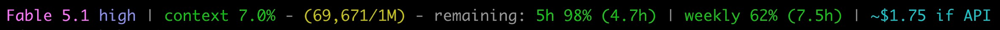

# Claude Code status line -- context and plan usage

A custom status line for [Claude Code](https://claude.com/claude-code) that
shows the model name and current effort level, percentage of the context
window consumed (color-coded green/yellow/red), exact token counts, the
*remaining* 5-hour-session and weekly rate-limit percentages with time until
each window resets (Pro/Max plans), the API-equivalent session cost, the
session ID, plus the familiar `user@host:dir (branch)` prefix.

Example output:

```
jos@laptop:myproj (main) Fable 5.1 high | context 31.9% - (318,911/1M) - remaining: 5h 62% (2.2h) | weekly 69% (5.3d) | ~$12.88 if API
```

Rendered (the `user@host:project` prefix comes from the wrapper; everything
from `(main)` onward is shown in the screenshot below, which predates the
shorter `context N%` / `1M` labels):



## Install

1. Drop both files in `~/.claude/`:

   ```bash
   GIST=https://gist.githubusercontent.com/josmithiii/72bb219437e881521e72028bf01bb99a/raw
   curl -o ~/.claude/statusline.js          $GIST/statusline.js
   curl -o ~/.claude/statusline-wrapper.js  $GIST/statusline-wrapper.js
   chmod +x ~/.claude/statusline.js ~/.claude/statusline-wrapper.js
   ```

2. Wire it up in `~/.claude/settings.json`:

   ```json
   {
     "statusLine": {
       "type": "command",
       "command": "~/.claude/statusline-wrapper.js",
       "padding": 0
     }
   }
   ```

3. Start a new Claude Code session -- the bar appears at the bottom.

## How it works

Everything is read from the JSON that Claude Code pipes to the status-line
command on stdin (documented at
<https://code.claude.com/docs/en/statusline.md>); no transcript parsing.

- `statusline-wrapper.js` (a bash script despite the `.js` name -- Claude
  Code only cares that it's executable) prepends `user@host:dir (branch)`
  and then pipes the original stdin JSON into `statusline.js`.
- The effort level after the model name (`Fable 5.1 high`) is the
  `effort.level` field -- one of `low`, `medium`, `high`, `xhigh`, `max`,
  tracking `/effort` live. The whole `effort` block is omitted for models
  that don't support effort levels, and the status line then shows the bare
  model name. Note that `ultracode` reports as `xhigh`, its underlying
  effort level.
- `context N% - (used/size)` comes from the `context_window` block:
  `current_usage` is the usage record of the newest main-context API
  response, and the script reports
  `input + output + cache_read + cache_creation` (everything that occupied
  the window on the last turn) as a percentage of `context_window_size`.
  The size is shown compactly (`1M`, `200K`), so the script adapts to
  whichever model is active. Before the first response the segment reads
  `context usage starts after your first question.`
- The `remaining: 5h N% (…h) | weekly N% (…d)` segments are read from the
  `rate_limits.five_hour` and `rate_limits.seven_day` blocks. Each shows the
  percentage *remaining* in that window (100 minus `used_percentage`)
  followed by the time until the window resets; the green/yellow/red color
  still tracks usage, so the number turns red as it approaches 0%
  remaining. A `spend N%` segment is added only when Claude Code supplies
  `rate_limits.spend_limit` (Claude apps gateway users).
  See: <https://code.claude.com/docs/en/statusline.md#rate-limit-usage>
- `~$1.23 if API` is the `cost.total_cost_usd` field -- Claude Code's
  client-side estimate of the current session's spend. It prices tokens at
  standard per-token API rates with no knowledge of the Max subscription, so
  read it as "what this session would cost at pay-as-you-go API rates" -- the
  on-demand bill Max avoids. It is a running dollar total (not a percentage),
  shown in neutral cyan, so the green/yellow/red usage scale does not apply.
  It is a client-side estimate and "may differ from your actual bill." Note
  that Claude Code exposes *no* remaining-credit balance to the status line;
  this session-cost estimate is the closest available signal.
- **`<unavailable>`** (in red) is printed in place of any of the above values
  that Claude Code failed to supply -- for example the rate-limit blocks
  during a usage-service outage. A missing field is never silently dropped.
  Note that the rate-limit fields are only ever sent to Claude.ai Pro/Max
  subscribers (and only after the session's first API response), so on other
  plans those two segments read `<unavailable>` permanently; delete them from
  `rateLimitLabels()` if that bothers you.

## Tweaks

- Adjust the color thresholds (90% red, 70% yellow) in `color()`.
- Recolor the effort label (bright blue, `\x1b[94m`) or drop it entirely by
  setting `effort` to `""` near the top of `statusline.js`.
- Other fields Claude Code puts on stdin but this script ignores:
  `fast_mode`, `thinking.enabled`, `output_style.name`, `vim.mode`,
  `agent.name`, `session_name`, `pr`, `worktree`, `prompt_cache`,
  `context_window.used_percentage` (input tokens only, which is why the
  script computes its own from `current_usage`).
- Drop the wrapper and point `statusLine.command` straight at
  `statusline.js` if you don't want the user/host/branch prefix.

## License

MIT
